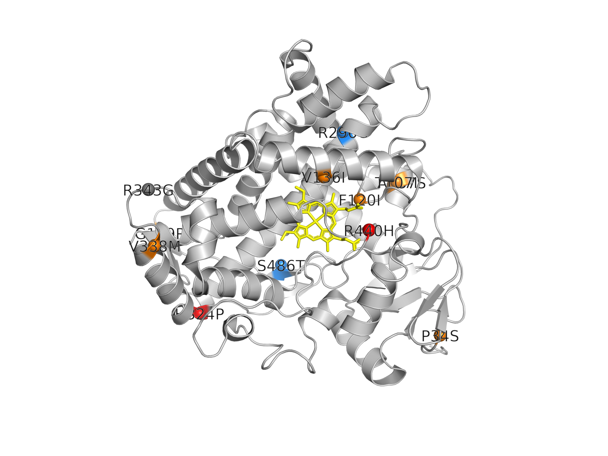
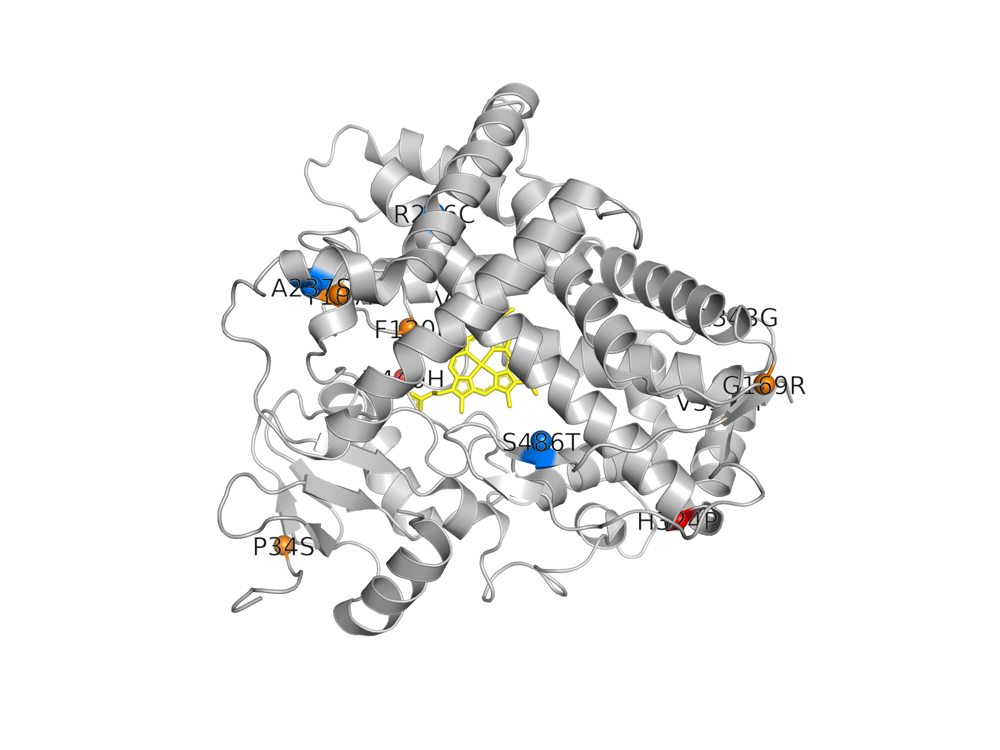
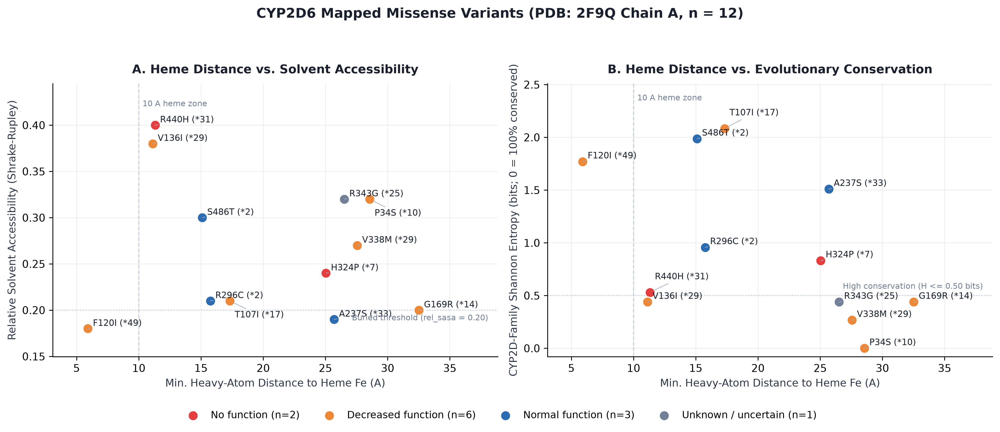
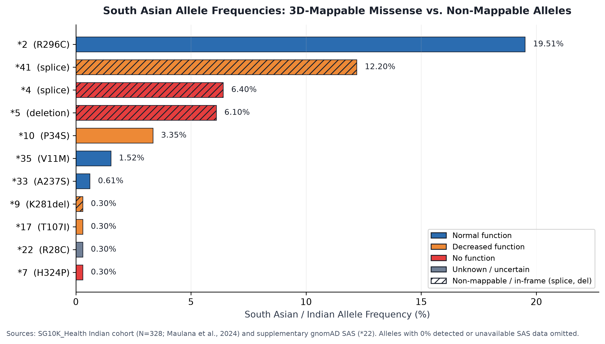
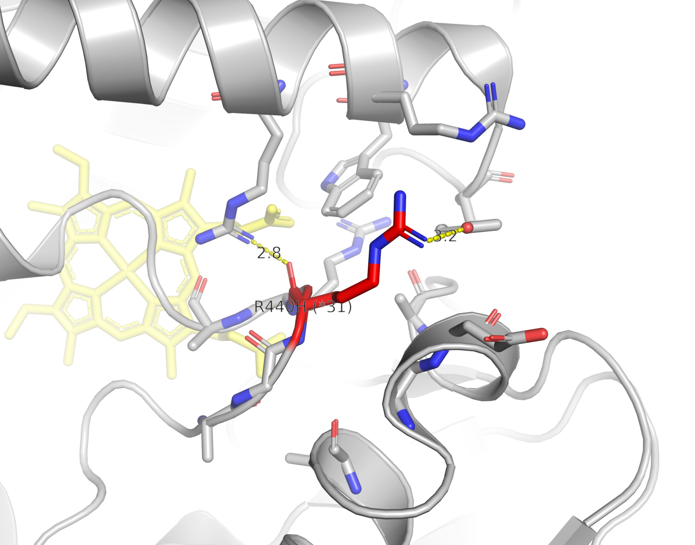
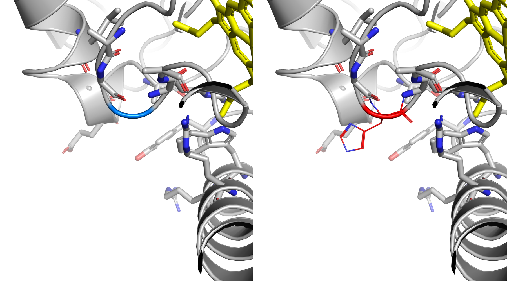
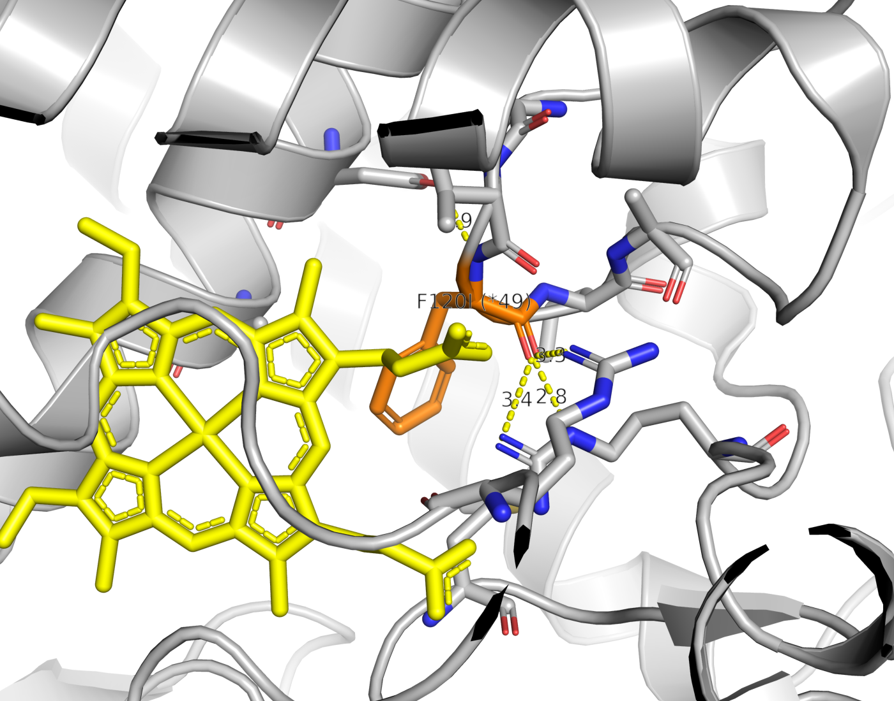
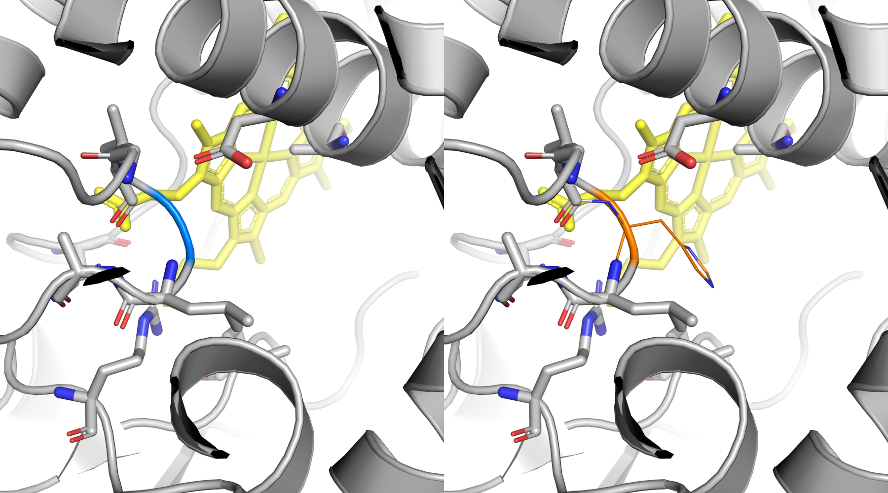
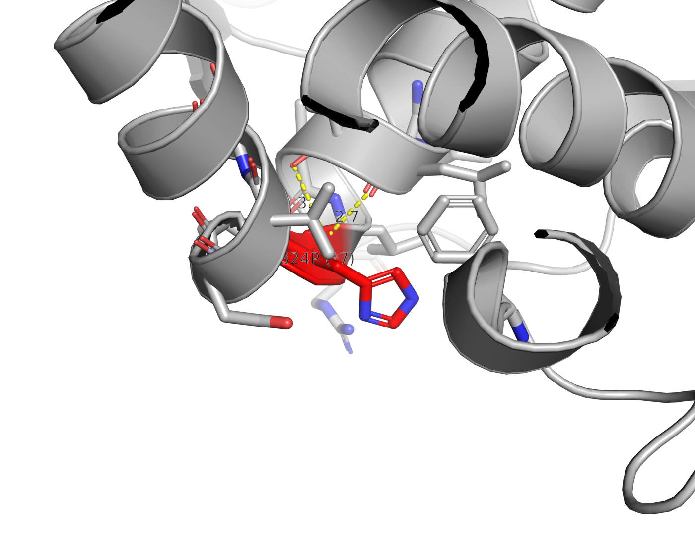
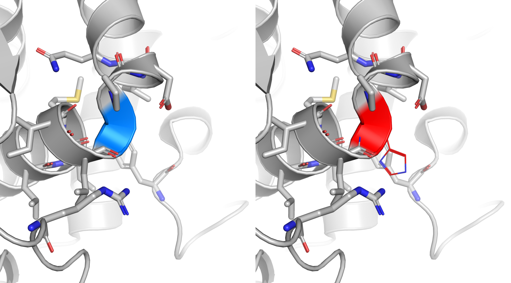

# CYP2D6 Structural Variant Atlas

A reproducible, scripted structural-bioinformatics pipeline mapping clinically curated human **CYP2D6** star-allele variants onto the crystal structure (**PDB: 2F9Q**, Chain A), combining 3D structural metrics, mammalian CYP2D-family sequence conservation, and South Asian population allele frequency context.

## 3D Overview of Mapped Missense Variants

| Front View (Active-Site Face) | Back View (180° Y-Rotation) |
| :---: | :---: |
|  |  |

*Color key across all 3D renders and summary charts: **Blue (`marine`)** = normal function, **Orange** = decreased function, **Red** = no function, **Grey** = unknown/uncertain function, **Yellow sticks** = catalytic heme (`HEM`).*

---

## Project Motivation & Clinical Context

Cytochrome P450 2D6 (*CYP2D6*) is a highly polymorphic hepatic enzyme central to psychiatric pharmacogenomics. Clinical guidelines from **CPIC** and **DPWG** provide actionable *CYP2D6* genotype-guided dosing recommendations across multiple SSRIs/SNRIs (paroxetine, fluvoxamine, venlafaxine, vortioxetine), tricyclic antidepressants (amitriptyline, nortriptyline), and antipsychotics (aripiprazole, brexpiprazole, haloperidol, pimozide, risperidone, zuclopenthixol). See [`docs/background.md`](docs/background.md) for guideline details.

This atlas links PharmVar/CPIC clinical classifications with 3D structural location (`2F9Q` Chain A), solvent accessibility, evolutionary conservation, and South Asian allele frequencies in a single script-driven repository.

---

## Key Findings

### 1. Structural & Evolutionary Metrics (`n = 12` Resolved Missense Variants)



| CPIC Function Class | Mapped `n` | Min. Heme Fe Distance Median [Range] (Å) | Relative SASA Median [Range] | CYP2D-Family Entropy Median [Range] (bits) |
| :--- | :---: | :---: | :---: | :---: |
| **No function** | 2 | 18.18 [11.31–25.04] | 0.32 [0.24–0.40] | 0.681 [0.530–0.832] |
| **Decreased function** | 6 | 22.43 [5.91–32.52] | 0.24 [0.18–0.38] | 0.439 [0.000–2.084] |
| **Normal function** | 3 | 15.75 [15.10–25.69] | 0.21 [0.19–0.30] | 1.509 [0.957–1.986] |
| **Unknown / uncertain (`*25` R343G)** | 1 | 26.52 [26.52–26.52] | 0.32 [0.32–0.32] | 0.439 [0.439–0.439] |

* **Evolutionary constraint separates clinical classes more cleanly than 3D distance alone:** Normal-function polymorphisms sit at variable mammalian CYP2D positions (median Shannon entropy `1.509` bits), whereas decreased-function (`0.439` bits) and no-function (`0.681` bits) variants cluster at substantially more conserved sites.
* **Impaired function occurs through distinct structural mechanisms:**
  * *Direct active-site perturbation:* `F120I` (`*49`, decreased function) lies closest to the catalytic heme iron (`5.91 Å`) on the B–C substrate-recognition loop (SRS1), where sequence variability reflects substrate-specificity tuning across mammalian CYP2D paralogues.
  * *Proximal heme-loop disruption:* `R440H` (`*31`, no function; `11.31 Å`) sits immediately upstream of the heme-coordinating cysteine (`C443`).
  * *Distal structural/folding destabilization:* `P34S` (`*10`, decreased function) occupies a 100% conserved position (`0.000` bits) in the N-terminal proline-rich hinge region despite lying >28 Å from the heme iron; `H324P` (`*7`, no function; `25.04 Å`) introduces a helix-breaking proline inside the I-helix.
* **Uncertain-function observation:** `R343G` (`*25`, CPIC uncertain function) sits distally (`26.52 Å`, `rel_sasa = 0.32`) at a conserved site (`0.439` bits). This is noted purely as a structural observation and does not reassign its clinical classification.

### 2. South Asian Population Context & Non-Mappable Alleles



In the SG10K_Health Indian WGS cohort (`N = 328`; Maulana et al., 2024), three major clinically actionable alleles—**`*41` (12.20%, intronic splicing)**, **`*4` (6.40%, canonical splice site)**, and **`*5` (6.10%, whole-gene deletion)**—cannot be mapped onto a single missense coordinate in 3D. Logging non-mappable alleles explicitly in [`data/processed/variants_not_mappable.csv`](data/processed/variants_not_mappable.csv) prevents overstating the clinical coverage of a missense-only structural map.

---

## Showcase Local Environments & Illustrative Mutagenesis

| Variant (Allele / Function) | Wild-Type 5 Å Environment & Polar Contacts | Illustrative WT vs. Mutant (PyMOL Wizard) |
| :--- | :---: | :---: |
| **`R440H`** (`*31`, No function)<br>Proximal heme-binding loop (`11.31 Å` to Fe) |  |  |
| **`F120I`** (`*49`, Decreased function)<br>Active-site B–C loop (`5.91 Å` to Fe) |  |  |
| **`H324P`** (`*7`, No function)<br>Buried I-helix proline insertion (`25.04 Å` to Fe) |  |  |

> **Important Methodological Note:** Side-by-side WT vs. mutant panels (`mutagenesis_*.png`) were generated with PyMOL's Mutagenesis Wizard using backbone-dependent rotamer selection with minimal steric clashes. They are **strictly illustrative**—no energy minimization, backbone relaxation, molecular dynamics, or folding free-energy ($\Delta\Delta G$) calculations were performed. All 12 automated per-variant close-up renders are available in [`figures/closeups/`](figures/closeups/).

---

## Methods & Pipeline Architecture

| Step | Script | Purpose & Outputs |
| :---: | :--- | :--- |
| **1** | `scripts/01_fetch_data.py` | Downloads PDB `2F9Q` (`structures/2F9Q.pdb`) and UniProt `P10635` (`data/raw/P10635.fasta`). |
| **2** | `scripts/02_build_variant_table.py` | Parses 21 curated PharmVar/CPIC variants (`data/raw/cyp2d6_variants_curated.csv`) into 15 missense (`variants_mappable.csv`) and 6 non-mappable/in-frame (`variants_not_mappable.csv`) alleles; verifies 100% WT residue match against `P10635`. |
| **3** | `scripts/03_structural_features.py` | Strips waters and isolates `2F9Q` Chain A; computes minimum heavy-atom distance to `HEM:FE` and Shrake–Rupley relative SASA (Tien et al., 2013 Max ASA) into `variants_structural.csv`. |
| **4** | `scripts/04_conservation.py` | Computes CYP2D-family Shannon entropy ($H = -\sum p_i \log_2 p_i$; columns with >30% gaps masked) from reviewed mammalian CYP2D sequences aligned via EBI Clustal Omega (`data/raw/cyp2d_family_aln.fasta`) and merges into `variants_final.csv`. |
| **5** | `scripts/05_render_figures.py` | Headless PyMOL rendering of `overview_front.png`, `overview_back.png`, `pymol/cyp2d6_atlas_final.pse`, and uniform 5 Å close-ups (`figures/closeups/closeup_*.png`). |
| **6** | `scripts/06_summary_plot.py` | Generates `summary_structural_metrics.png` and `summary_sas_frequencies.png` with Matplotlib and prints per-class descriptive summaries. |

---

## Reproducing the Pipeline

### 1. Clone and Create the Environment
```bash
git clone https://github.com/Ayan-Goswami/cyp2d6-structural-variant-atlas.git
cd cyp2d6-structural-variant-atlas
mamba env create -f environment.yml
conda activate pymol-atlas
```

### 2. Run the Full Analysis & Figure Pipeline
```bash
python scripts/01_fetch_data.py
python scripts/02_build_variant_table.py
python scripts/03_structural_features.py
python scripts/04_conservation.py
pymol -cq scripts/05_render_figures.py
python scripts/06_summary_plot.py
```

---

## Repository Structure

```text
cyp2d6-structural-variant-atlas/
├── environment.yml                 # Reproducible conda/mamba environment
├── README.md                       # Project overview, results, and reproduction guide
├── data/
│   ├── raw/
│   │   ├── cyp2d6_variants_curated.csv   # 21 curated PharmVar/CPIC variants + SAS frequencies
│   │   ├── P10635.fasta                  # UniProt canonical human CYP2D6 sequence (497 aa)
│   │   ├── cyp2d_family_unaligned.fasta  # Reviewed mammalian CYP2D sequences (UniProt)
│   │   └── cyp2d_family_aln.fasta        # Clustal Omega MSA (Pearson/FASTA)
│   └── processed/
│       ├── variants_mappable.csv         # 15 single-residue missense variants
│       ├── variants_not_mappable.csv     # 6 splice, frameshift, deletion, in-frame alleles
│       ├── variants_structural.csv       # Heme distance & relative SASA (2F9Q Chain A)
│       ├── conservation.csv              # Per-residue Shannon entropy (positions 1–497)
│       └── variants_final.csv            # Master merged dataset
├── structures/
│   └── 2F9Q.pdb                    # Human CYP2D6 crystal structure (RCSB PDB)
├── scripts/                        # Numbered reproducible pipeline scripts (01–06)
├── figures/
│   ├── overview_front.png          # Automated front 3D overview
│   ├── overview_back.png           # Automated back 3D overview
│   ├── summary_structural_metrics.png
│   ├── summary_sas_frequencies.png
│   └── closeups/                   # 12 automated close-ups + 3 illustrative mutagenesis PNGs
├── pymol/
│   ├── cyp2d6_atlas_final.pse      # Final styled PyMOL overview session
│   └── day09_mutagenesis.pse       # Interactive mutagenesis comparison session
└── docs/
    ├── decisions.md                # Structure selection rationale (2F9Q Chain A)
    ├── background.md               # CPIC/DPWG psychiatric pharmacogenomics background
    └── results.md                  # Detailed local contacts and analytical notes
```

---

## Scope, Limitations & Future Work

* **Non-mappable clinical alleles (`6/21`):** Frameshifts (`*3`, `*6`), splicing defects (`*4`, `*41`), whole-gene deletions (`*5`), and in-frame deletions (`*9`) cannot be represented as single missense substitutions on a static crystal structure and are tracked separately in `variants_not_mappable.csv`.
* **Unresolved crystal regions (`3/15` missense):** `2F9Q` lacks the truncated N-terminal membrane anchor and flexible regions; consequently, `V11M` (`*35`), `R28C` (`*22`), and `G42R` (`*12`) are flagged `in_structure = False` and excluded from 3D metrics while retaining sequence-conservation scores.
* **Single static conformation:** `2F9Q` represents a ligand-free state; CYP2D6 undergoes conformational remodeling upon ligand binding (e.g., prinomastat-bound `3QM4` or thioridazine-bound `4WNW`).
* **CYP2D-family vs. strict orthologue conservation:** Mammalian *CYP2D* loci undergo lineage-specific gene expansions (e.g., mouse/rat paralogues), so Shannon entropy reflects family-level constraint rather than 1-to-1 orthologue conservation.
* **Population data & *CYP2D6/CYP2D7* homology:** Short-read SNP repositories (gnomAD) suffer from read misalignment with the *CYP2D7/2D8* pseudogenes and miss structural variants; accordingly, WGS star-allele calls (SG10K_Health) and targeted Indian cohort studies were prioritized, with gnomAD used strictly as supplementary data (explicitly tagged in `freq_source`). Six alleles without reliable South Asian data were left blank rather than imputed.
* **Small curated sample size:** Because mapped class counts range from `n = 1` to `6`, quantitative patterns are reported descriptively using medians and ranges without underpowered significance tests.
* **Future Work:** Incorporate controlled-access Indian genomic cohorts (such as **GenomeIndia**, not accessed in this public build), compare substrate-bound CYP2D6 conformations (`3QM4`, `4WNW`), and pair structural features with physics-based stability estimators (e.g., FoldX or Rosetta $\Delta\Delta G$).

---

## Data Sources & References

1. **PharmVar Consortium** — *CYP2D6* Gene Page (`NM_000106.6`, accessed `2026-11-24`): https://www.pharmvar.org/gene/CYP2D6
2. **CPIC & DPWG Guidelines** — Clinical Pharmacogenetics Implementation Consortium (SSRIs/SNRIs, 2023; TCAs, 2017) and Dutch Pharmacogenetics Working Group (Antipsychotics, 2023): https://cpicpgx.org/guidelines/ | https://www.clinpgx.org/
3. **PDB 2F9Q** — Rowland P. et al. (2006). *Crystal structure of human cytochrome P450 2D6.* J. Biol. Chem. 281(11):7614–7622. https://www.rcsb.org/structure/2F9Q
4. **UniProt P10635** — Human Cytochrome P450 2D6 reference sequence & reviewed mammalian CYP2D entries: https://www.uniprot.org/uniprotkb/P10635
5. **South Asian Allele Frequencies** — Maulana Y. et al. (2024). *Scientific Reports* (SG10K_Health Indian cohort, `N = 328`, PMID: 39030343); Naveen A.T. et al. (2006). *Biol. Pharm. Bull.* (South Indian cohort, `N = 447`, PMID: 16880622); Manoharan A. et al. (2019). *Pharmacogenomics* (Indian *CYP2D6* resequencing, PMID: 31368850).
6. **Relative SASA Normalization** — Tien M.Z. et al. (2013). *Maximum allowed solvent accessibilities of residues in proteins.* PLoS ONE 8(11):e80635.
7. **Software** — Open-Source PyMOL, Biopython, Pandas, NumPy, Matplotlib, and EBI Clustal Omega.
